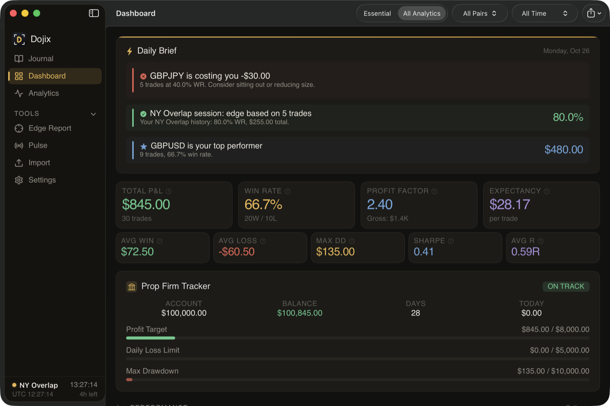
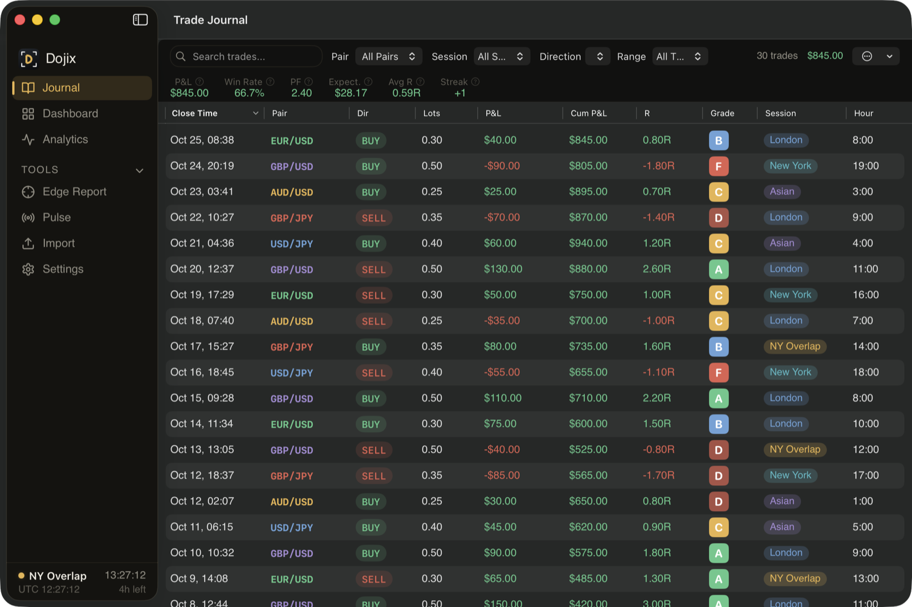
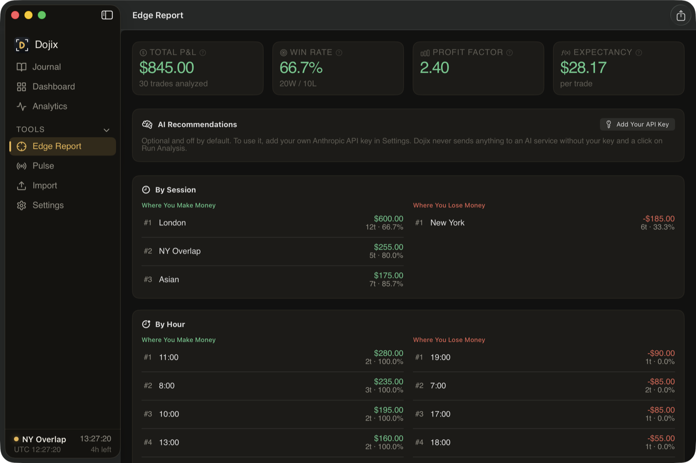
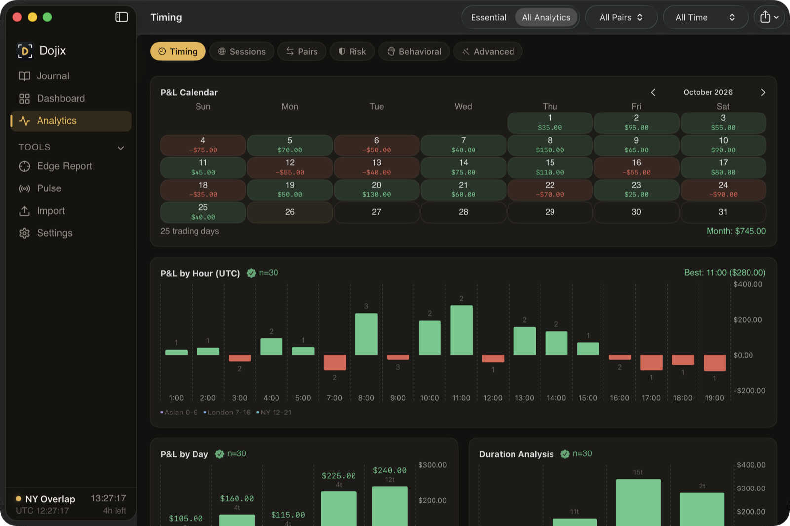
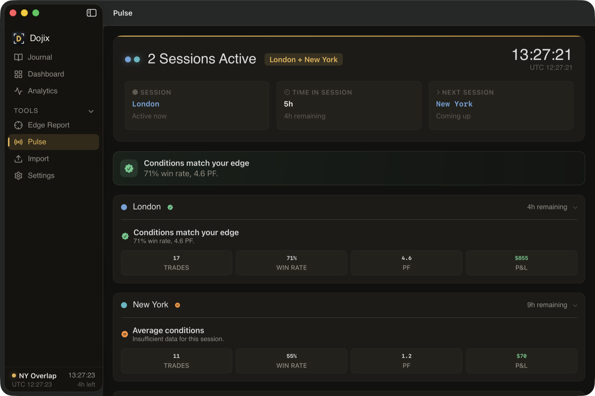

# Dojix

**A free, open-source trade journal for forex traders on the Mac that shows you, in dollars, where you make money and where you lose it.**

Import your trade history from MetaTrader or your broker, and Dojix turns it into a
journal, a dashboard of more than 60 analytics, and an Edge Report that ranks the
sessions, hours, days and pairs that help or hurt you. Your trades never leave your Mac.

> Free and open source (GPL-3.0) · native macOS app · **Windows version coming soon.**

Created by [Douglas Cleary](https://github.com/djctwo).



| Journal | Edge Report |
| --- | --- |
|  |  |
| **Analytics** | **Pulse** |
|  |  |

*Screenshots show the built-in sample trades. Every number in them is made up.*

## Why Dojix

- **Free and open source.** Every feature is available to everyone. No trial, no tiers,
  no upgrade screen. The full source code is in this repository under the GPL-3.0.
- **Everything stays on your Mac.** Your journal is a local, encrypted database. There is
  no account to create, no subscription, no cloud sync and no telemetry.
- **App Lock protects the journal with your password.** The journal is always encrypted
  on disk; with App Lock on, its key is sealed with your password, so nothing can be
  decrypted until you unlock Dojix.
- **AI is optional and uses your own key.** If you add your own Anthropic API key, the
  Edge Report can write recommendations. Only summary statistics are sent, never your
  individual trades or notes, and only when you click *Run Analysis*.
- **Imports from the platforms forex traders use:** MetaTrader 4, MetaTrader 5
  (StrategyAnalytics CSV), cTrader, TradingView, OANDA (CSV or API), Interactive Brokers,
  thinkorswim, NinjaTrader, and any other CSV through a column-mapping screen.

## Features

- **Journal:** every trade with pair, direction, size, P&L, R-multiple, MAE/MFE, session
  and hour. Search, filter, sort, grade (A to F), replay, and add notes, tags, emotions,
  checklists, commission/swap and screenshots.
- **Dashboard and Analytics:** win rate, profit factor, expectancy, drawdown, equity
  curve, P&L calendar, hour/day/session heatmaps, streaks, Monte Carlo, risk of ruin,
  position sizing, kill-zone optimizer, a "what to cut" advisor, prop-firm tracker,
  strategy checkpoints and more. An *Essential* view keeps it simple.
- **Edge Report:** your top 5 places to make and lose money by session, hour, day and
  pair, plus bias-alignment and volatility breakdowns. Export as PDF or CSV.
- **Imports:** re-importing the same file never creates duplicates. Dojix can also watch
  your MT5 files folder and import new StrategyAnalytics exports automatically.
- **Pulse:** live session clock, economic calendar with "danger zones" around big news,
  and optional live prices.
- **Sample trades:** *Settings > Data > Load Sample Trades* adds 30 fictional trades so
  you can explore before importing your own; *Remove Sample Trades* takes only those out.
  To try an import, drop `samples/sample-mt4.csv` (five made-up trades) onto the Import
  screen.
- **Encrypted journal:** the database and your trade screenshots are encrypted on disk
  (AES-256-GCM). The decrypted journal exists only in memory while Dojix runs. The key is
  in your macOS Keychain.
- **App Lock with idle auto-lock:** locks after the idle time you choose (Off, 1, 5, 15,
  30 or 60 minutes; default 15) and whenever the Mac sleeps, the screen locks, or you hide
  or minimize Dojix. There is no password recovery: a forgotten password means erasing the
  local data and restoring from a backup.
- **Older-copy check:** every save is numbered, inside the encrypted file and in the
  Keychain. If an older copy of the journal is put back on disk, Dojix tells you and opens
  it only after you confirm (with App Lock on, only with your password).
- **Password-protected backups:** backups can be encrypted with a password (AES-256-GCM,
  PBKDF2-SHA256 with 600,000 iterations; recommended), and every restore is checked before
  anything is replaced. A backup without a password is not encrypted.

### Optional online features (your own keys, off by default)

Dojix works fully offline. These extras run only if you add your own key in Settings,
and any usage is billed by that provider to you:

| Feature | Provider | What is sent |
| --- | --- | --- |
| AI recommendations (Edge Report > Run Analysis) | Anthropic | A summary of your statistics (totals and P&L/win rate by session, hour, day, pair, bias, volatility). Never individual trades, tickets or notes. Only when you click. |
| Live prices | Twelve Data, Polygon.io, OANDA, or MetaTrader 5 (local file, no key) | The currency pairs on your watchlist |
| OANDA import | OANDA | Your OANDA token and account ID, to fetch your own history |

The economic calendar (Pulse) downloads the public weekly calendar from
nfs.faireconomy.media; nothing about you is sent. All connections use HTTPS.

## Install

Requires macOS 14 Sonoma or later.

1. Open the [Releases page](https://github.com/djctwo/dojix/releases) and download
   `Dojix-macOS-unsigned.zip` from the latest release.
2. Unzip it and drag **Dojix.app** to your Applications folder.

### Opening an unsigned app

Dojix is not signed with an Apple Developer ID or notarized, so the first time you open it
macOS says it "can't be opened" or "cannot verify the developer". To open it:

1. In Finder, **right-click** (or Control-click) `Dojix.app`, choose **Open**, then click
   **Open** in the dialog. You only need to do this once.
2. If there is no Open button (newer macOS versions): try to open the app once, then go
   to **System Settings > Privacy & Security**, scroll down to the message about Dojix
   and click **Open Anyway**.

Each release also has a `.sha256` file, so you can check the download with
`shasum -a 256 Dojix-macOS-unsigned.zip`. Because the app isn't signed with a developer
certificate, macOS may ask for your login password the first time a new version reads its
Keychain items (your API keys and the database key). Choose **Always Allow**.

### Build from source

Requirements: macOS 14 or later, Xcode 16 or later, and XcodeGen
(`brew install xcodegen`).

```bash
git clone https://github.com/djctwo/dojix.git
cd dojix
xcodegen generate
open Dojix.xcodeproj        # then Product > Run
```

Or from the command line:

```bash
xcodebuild -project Dojix.xcodeproj -scheme Dojix -configuration Release \
  -derivedDataPath build build
open build/Build/Products/Release/Dojix.app
```

Debug builds use the bundle ID `com.dojix.app.dev`, so they keep their own data folder
and Keychain items and never touch an installed copy of Dojix. Release builds use
`com.dojix.app` and store data in `~/Library/Application Support/Dojix/`; they ignore
the `DOJIX_DATA_DIR`, `DOJIX_KEYCHAIN_SERVICE` and `DOJIX_MT5_DIR` development
overrides and are built without the debugging entitlement (`get-task-allow`).

Run the unit tests with:

```bash
xcodebuild test -project Dojix.xcodeproj -scheme Dojix -only-testing:DojixTests \
  DOJIX_BUNDLE_ID=com.dojix.app.test
```

## MetaTrader 5 notes

- `mt5/DojixPriceFeed.mq5` is a small Expert Advisor that writes live bid/ask prices for
  your chosen symbols to `DojixPrices.json` in MT5's Common Files folder once a second.
  Pick "MT5 Direct" as the live data source to use it (no API key needed).
- For MT5 history, Dojix reads the 32-column "StrategyAnalytics" CSV format (files named
  `StrategyAnalytics_Results_*.csv`). The script that writes that format is not part of
  this repository; any other CSV export can be imported through the column-mapping screen.
- Times in StrategyAnalytics files are broker-server time and are currently read as UTC,
  so hour and session statistics from those files can be shifted by your broker's offset.

## License

Copyright (C) 2026 Douglas Cleary. Dojix is free software under the
[GNU General Public License v3.0](LICENSE). See [NOTICE](NOTICE) for third-party
components, [CONTRIBUTING.md](CONTRIBUTING.md) for how to report issues, and
[SECURITY.md](SECURITY.md) for reporting vulnerabilities.

Dojix is a journaling tool, not financial advice.

## Other projects

[Greenwick](https://github.com/djctwo/greenwick), the trading journal for stock and day
traders, and [Athorize](https://github.com/djctwo/athorize), a self-hosted
multi-framework compliance platform.
